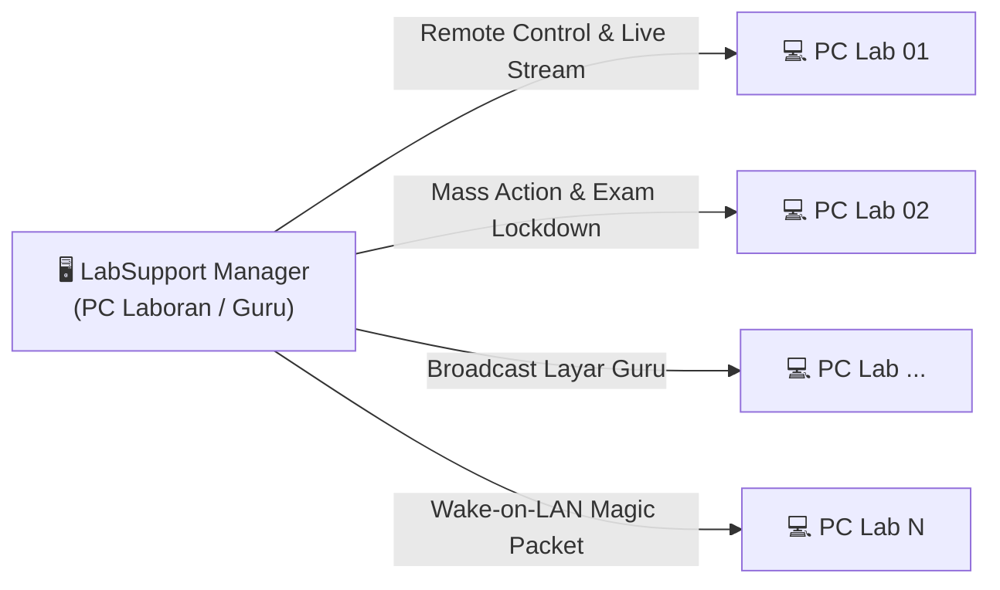

# LabSupport — Portable Computer Laboratory Management System

[](https://github.com/erickkucing/LabSupport/actions/workflows/ci.yml)
[](https://github.com/erickkucing/LabSupport/actions/workflows/release.yml)
[](https://github.com/erickkucing/LabSupport/releases/latest)
[](https://dotnet.microsoft.com/)
[](https://microsoft.com/windows)
[](LICENSE)

> **Sistem Manajemen dan Remote Laboratorium Komputer Native Windows Modern, Ringan, dan 100% Portabel (Tanpa Instalasi .NET Runtime).**

LabSupport adalah alternatif modern, cepat, dan open-source untuk perangkat lunak manajemen lab seperti NetSupport School. Dirancang khusus untuk PC Laboran/Guru dan PC Siswa di sekolah, kampus, dan pusat pelatihan komputer dengan arsitektur *self-contained single-file executable* yang dapat dijalankan langsung dari flash disk.

---

## ⚡ Tautan Cepat & Dokumentasi

- 📦 **[Unduh Rilis Portable Terbaru (.zip)](https://github.com/erickkucing/LabSupport/releases/latest)**
- 📖 **[Panduan Deployment & Instalasi Lengkap](docs/DEPLOYMENT_GUIDE.md)**
- 📐 **[Spesifikasi Arsitektur & Protokol Komunikasi](docs/ARCHITECTURE.md)**

---

## 🌟 Fitur Utama



### 1. 🚀 100% Portabel & Tanpa Ketergantungan Eksternal
- **Self-Contained Executable**: .NET 8 runtime sudah di-embed langsung ke dalam binary `.exe`.
- Cukup salin folder atau colok flash disk USB, langsung jalan di Windows 10 dan Windows 11 64-bit tanpa perlu menginstal framework tambahan.

### 2. 🖥️ Dashboard Real-Time & Live Monitoring
- Grid thumbnail interaktif dengan pembaruan snapshot visual, CPU, dan RAM berkala setiap 5 detik.
- Indikator status otomatis: **Online** (hijau) dan **Offline** (abu-abu) berbasis deteksi heartbeat pintar.
- Penyaringan cepat berdasarkan nama komputer, IP, atau status aktif.

### 3. 🖱️ Remote Desktop Interaktif & Broadcast Layar Guru
- **Remote Kontrol Penuh**: Streaming visual berbasis MJPEG berkecepatan tinggi dengan kendali mouse (klik kiri, kanan, ganda, drag, scroll) dan pengetikan keyboard jarak jauh.
- **Broadcast Layar Guru**: Menyiarkan layar PC Guru ke seluruh PC Siswa secara serentak (mode presentasi kiosk fullscreen).
- Tombol kendali cepat: Win+D, Alt+F4, Task Manager (Ctrl+Shift+Esc), Kunci Layar, dan Tangkapan Layar PNG.

### 4. 🔒 Keamanan Ujian & Pengawasan Ketat (Exam Guard)
- **Exam Lockdown**: Mengunci komputer siswa dalam mode ujian terisolasi, mematikan Task Manager, kombinasi tombol Alt+Tab / Win, dan menutup paksa aplikasi non-ujian (*blacklisted processes*).
- **USB Storage Blocker**: Mengunci port USB agar media penyimpanan eksternal tidak dapat dibaca untuk mencegah kebocoran soal atau penyebaran malware.
- **Firewall & Web Blocker**: Memblokir akses domain tertentu (sosial media, game, dsb.) secara otomatis.

### 5. 📁 Distribusi File & Eksekusi Skrip Multi-PC
- **File Distribution**: Kirim materi pelajaran, modul praktikum, atau file tugas ke seluruh komputer siswa hanya dengan satu klik.
- **Broadcast Script Engine**: Jalankan skrip PowerShell dan Batch (CMD) secara massal ke semua PC lab dengan penanganan batas waktu (*timeout*) dan laporan output (stdout/stderr) transparan.
- **Template Skrip Cepat**: Flush DNS, Info Hardware, Pembersihan File Temp, dan Tes Koneksi Jaringan.

### 6. ⚡ Manajemen Daya & Wake-on-LAN (WoL)
- **Wake-on-LAN**: Menyalakan komputer yang mati melalui transmisi UDP Magic Packet ke alamat fisik MAC address.
- **Remote Shutdown, Restart, dan Lock Screen** massal saat sesi praktikum selesai.

### 7. 🔄 Zero-Touch Auto-Discovery & Dynamic IP Self-Healing
- Ketika IP PC Guru berubah (misal router DHCP me-reset IP), PC Siswa otomatis mendeteksi IP baru melalui UDP Beacon (port `5903`) dalam kurun waktu 5–10 detik tanpa perlu setting ulang manual.

---

## 🌐 Port Jaringan yang Digunakan

| Port | Arah Aliran | Protokol | Fungsi Utama |
|---|---|---|---|
| **8080** | PC Siswa ➔ PC Guru | HTTP (TCP) | Pengiriman Heartbeat, thumbnail snapshot, unduhan installer, dan file transfer |
| **5901** | PC Guru ➔ PC Siswa | HTTP (TCP) | Streaming visual layar MJPEG untuk remote control dan presentasi |
| **5902** | PC Guru ➔ PC Siswa | TCP Socket | Pengiriman perintah jarak jauh (Skrip, Shutdown, Lock, Exam Guard) |
| **5903** | Dua Arah (Broadcast) | UDP Socket | Beacon Auto-Discovery & Dynamic Reconnection saat IP berubah |
| **9 / 7** | PC Guru ➔ Subnet | UDP Broadcast | Magic Packet Wake-on-LAN untuk menghidupkan PC yang mati |

---

## 🚀 Panduan Memulai Cepat (Quickstart)

### 1. Menjalankan PC Manajemen (Guru / Laboran)
1. Unduh `LabSupport-Manager-v1.0.0.zip` dari [GitHub Releases](https://github.com/erickkucing/LabSupport/releases/latest).
2. Ekstrak file ZIP ke flash disk atau folder lokal.
3. Klik kanan `setup_manager_permissions.bat` dan pilih **Run as administrator** *(hanya perlu dijalankan satu kali untuk reservasi URL port 8080 dan Windows Firewall)*.
4. Buka `LabSupport.Manager.exe`.

### 2. Memasang Agent di PC Laboratorium (Siswa)
1. Pada aplikasi Manager, masuk ke menu tab **Generate Agent**.
2. Pilih IP Address LAN PC Manager yang terdeteksi, lalu klik **Generate Paket Agent**.
3. Salin folder hasil generate ke flash disk USB (`install_agent.bat`, `install_agent.ps1`, dan `LabSupport.Agent.exe`).
4. Tancapkan USB ke PC Siswa, lalu klik ganda **`install_agent.bat`**.
5. Skrip akan otomatis menguji ping ke Manager, mendaftarkan Windows Service `LabSupportAgent` (*Automatic*), dan menjalankannya secara hening (*headless*).
6. PC Siswa akan langsung tampil online di Dashboard PC Guru!

---

## 📂 Struktur Repositori

```
LabSupport/
├── .github/workflows/          # Pipeline CI/CD GitHub Actions
│   ├── ci.yml                  # Build & xUnit test otomatis di push/PR
│   └── release.yml             # Build & publish portable ZIP ke GitHub Releases
├── docs/                       # Dokumentasi teknis terperinci
│   ├── ARCHITECTURE.md         # Arsitektur sistem & spesifikasi protokol
│   └── DEPLOYMENT_GUIDE.md     # Panduan instalasi dan deployment lab
├── LabSupport.Shared/           # Library bersama: model, protokol, dan database SQLite
├── LabSupport.Agent/            # Headless Windows Service untuk PC Siswa/Client
├── LabSupport.Manager/          # Aplikasi desktop WPF GUI untuk PC Laboran/Guru
├── LabSupport.Tests/            # Suite pengujian xUnit (287 unit & integration tests)
├── setup_manager_permissions.bat # Skrip otomasi perizinan URL ACL & Firewall Manager
└── LabSupport.sln              # Solusi Microsoft Visual Studio / .NET 8
```

---

## 💻 Kompilasi dari Source Code

### Kebutuhan
- [.NET 8 SDK](https://dotnet.microsoft.com/download/dotnet/8.0)
- Git

### Kompilasi & Menjalankan Pengujian
```bash
# Clone repositori
git clone https://github.com/erickkucing/LabSupport.git
cd LabSupport

# Restore dependencies
dotnet restore LabSupport.sln

# Kompilasi seluruh solusi
dotnet build LabSupport.sln -c Release

# Jalankan seluruh unit & integration tests (287 tests)
dotnet test LabSupport.Tests/LabSupport.Tests.csproj -c Release
```

### Publish Paket Portable Mandiri (Self-Contained)
```bash
# Publish Agent (PC Siswa)
dotnet publish LabSupport.Agent -r win-x64 --self-contained true /p:PublishSingleFile=true -c Release -o ./dist/agent

# Publish Manager (PC Guru)
dotnet publish LabSupport.Manager -r win-x64 --self-contained true /p:PublishSingleFile=true -c Release -o ./dist/manager
```

---

## 📜 Lisensi & Kontribusi

Proyek ini didistribusikan di bawah lisensi **MIT License**. Kontribusi berupa pull request, pelaporan bug, dan saran fitur sangat dipersilakan!
