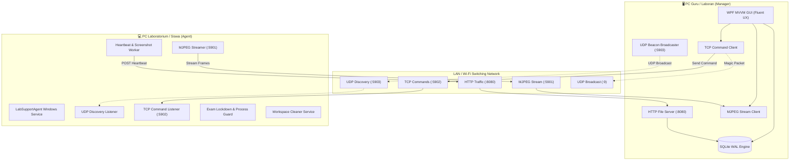
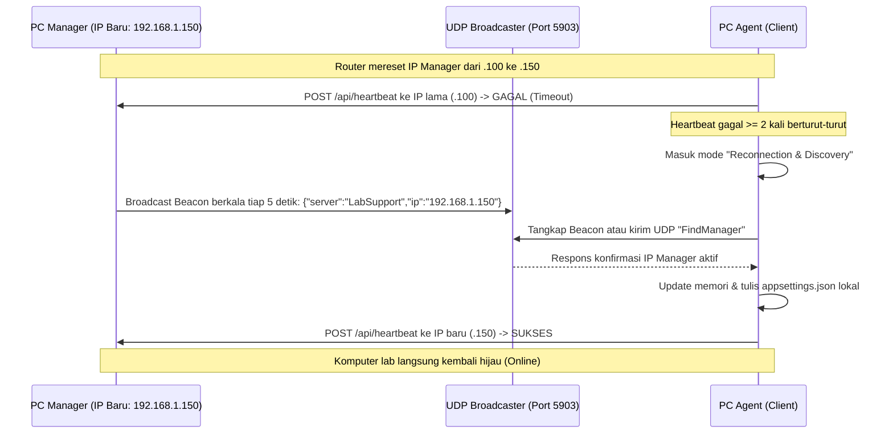

# Arsitektur & Spesifikasi Protokol LabSupport

Dokumen ini menjelaskan arsitektur internal, topologi jaringan, spesifikasi protokol komunikasi, dan alur data dari sistem manajemen laboratorium komputer **LabSupport**.

---

## 1. Topologi Jaringan & Komponen



---

## 2. Port Jaringan & Rincian Protokol

| Port | Transport | Arah Aliran | Deskripsi & Fungsi |
|---|---|---|---|
| **8080** | HTTP / TCP | Agent ➔ Manager | Health check, pengiriman Heartbeat (JSON + JPEG thumbnail Base64), unduhan installer Agent, dan distribusi file. |
| **5901** | HTTP / TCP | Manager ➔ Agent | Server streaming visual MJPEG langsung (*real-time screen monitoring* & *presentation broadcast*). |
| **5902** | TCP Socket | Manager ➔ Agent | Saluran eksekusi perintah terenkripsi ringan: Remote script (PowerShell/CMD), Shutdown, Restart, Lock Screen, USB Block, Audio Control, dan Lockdown Ujian. |
| **5903** | UDP Broadcast | Dua Arah | **Zero-Touch Auto Discovery & Dynamic IP Self-Healing**: Mengizinkan Agent mendeteksi perubahan IP Address PC Manager tanpa rekonfigurasi manual. |
| **9 / 7** | UDP Broadcast | Manager ➔ Subnet | Paket Magic Packet Wake-on-LAN (102 bytes) untuk menghidupkan komputer yang mati via kartu jaringan LAN. |

---

## 3. Spesifikasi Protokol Komunikasi

### A. Heartbeat Payload (Agent ➔ Manager via HTTP POST `http://<manager-ip>:8080/api/heartbeat`)

```json
{
  "computerName": "LAB-PC-01",
  "ipAddress": "192.168.1.101",
  "macAddress": "00:1A:2B:3C:4D:5E",
  "osVersion": "Microsoft Windows 11 Pro 10.0.22631",
  "cpuUsage": 14.5,
  "memoryUsage": 42.8,
  "status": "Online",
  "currentScreenBase64": "/9j/4AAQSkZJRg...",
  "activeUser": "student_01",
  "lastSeen": "2026-10-28T08:30:00Z"
}
```

- **Frekuensi Transmisi**: Setiap 5 detik sekali.
- **Throttling Database**: Manager menyimpan thumbnail di cache memori, dan hanya menulis ke disk SQLite jika IP/MAC berubah atau setiap interval flush 60 detik (menghemat disk I/O sebesar 95%).

### B. TCP Command Payload (Manager ➔ Agent via Port 5902)

Setiap frame perintah diawali dengan header panjang 4-byte *Big-Endian Integer* yang menunjukkan panjang payload UTF-8 JSON berikutnya:

```json
{
  "commandId": "b1a2c3d4-e5f6-7890-abcd-ef1234567890",
  "type": 3,
  "payload": "powershell.exe -NoProfile -Command \"Get-Process | Select-Object -First 5\"",
  "timeoutSeconds": 30
}
```

#### Tipe Perintah (`CommandType` Enum):
- `0` : **Shutdown** (Inisiasi *InitiateSystemShutdownEx*)
- `1` : **Restart** (Inisiasi *ExitWindowsEx*)
- `2` : **Lock** (Kunci sesi Windows via *LockWorkStation*)
- `3` : **ExecuteScript** (PowerShell / Batch asynchronously dengan batas timeout)
- `4` : **LockdownExam** (Aktifkan Exam Guard & blokir aplikasi non-ujian)
- `5` : **UnlockExam** (Pulihkan akses desktop normal)
- `6` : **BlockUsb** / **UnblockUsb** (Manipulasi registry *USBSTOR* start value)
- `7` : **FileTransfer** (Unduh file dari HTTP Manager ke direktori tujuan lokal)
- `8` : **SetAudioVolume** (Atur volume audio sistem atau *Mute*)
- `9` : **InjectClipboard** (Salin teks materi/link ke clipboard komputer siswa)

---

## 4. Mekanisme Zero-Touch Self-Healing (Perubahan IP Dinamis)

Dalam lingkungan sekolah atau kampus, PC Laboran/Guru sering kali mendapatkan IP baru dari DHCP saat router reboot atau berpindah subnet.



---

## 5. Keamanan & Pencegahan Gangguan

1. **UAC Elevation**: Script pemasangan (`install_agent.bat`) menyertakan manifest auto-elevasi Administrator dengan fallback PowerShell prompt.
2. **Crash-Proof Worker**: Agen berjalan sebagai Windows Service di bawah akun `LocalSystem` dengan Scheduled Task recovery pada logon sesi pengguna.
3. **Sandbox Script Execution**: Script yang dikirimkan dijalankan pada thread terpisah dengan proses *timeout watcher* untuk mencegah proses menggantung (*hung processes*).
